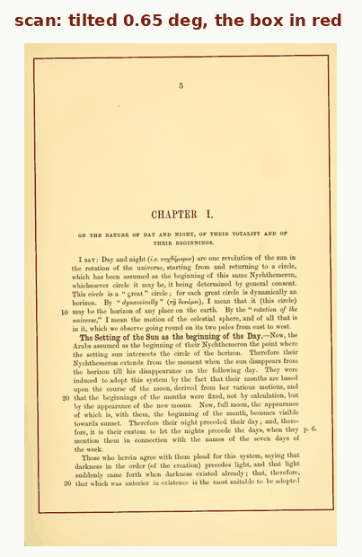
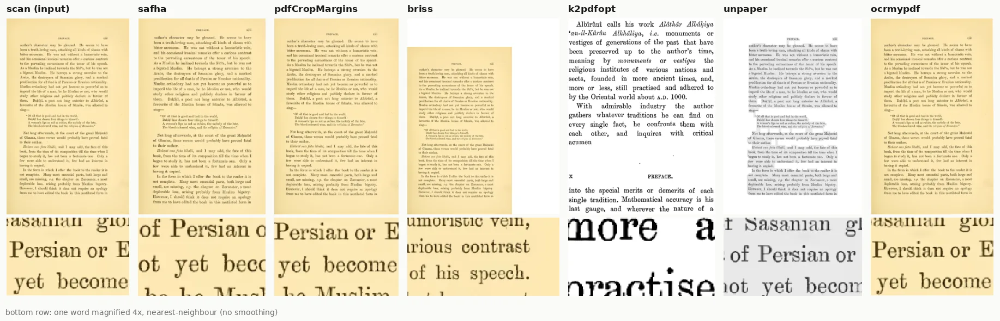
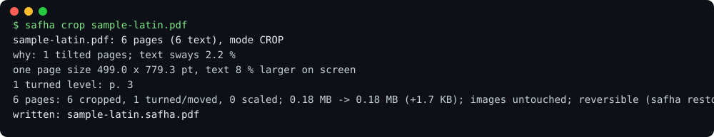

# safha

**Lossless crop, deskew and split for scanned book PDFs.** One box per book, centred on every page's text; tilted pages
levelled only when two measures agree; two-page spreads split; the scan's images never re-encoded. For reading on a
phone, a Kindle, a Kobo or a reMarkable, in any script.

[](https://github.com/kmbenjel/safha/actions/workflows/ci.yml)
[](https://pypi.org/project/safha/)
[](https://pypi.org/project/safha/)
[](LICENSE)
[](https://warraq.benjelloun.dev/safha/)


```bash
uvx safha demo                 # the bundled public-domain samples, before | after sheets, under a minute
pipx install safha
safha crop book.pdf            # -> book.safha.pdf: same images, same size, text larger on screen
```



*safha* (صفحة) is Arabic for "page".

## Why safha? How it compares

Scanned books read badly on small screens: wide margins shrink the text, pages sway from left to right, some are
tilted, some scans hold two pages. The usual fixes either crop page by page (every page a different size), or
rasterise and re-encode every page (the pixels are resampled, and a colour or grey scan comes back several times
bigger, or lossy).

safha does the whole job **through the PDF's drawing instructions**: each page's visible box and a transformation
matrix. The image streams stay byte for byte, the file keeps its size, and the original can be restored from the
output.

| | safha 0.1 | pdfCropMargins 2.2.1 | Briss 2.0a5 | k2pdfopt 2.55 | ScanTailor Advanced 1.0 | unpaper 7.0 | OCRmyPDF 15.2 `--deskew` |
|---|---|---|---|---|---|---|---|
| Keeps the scan's image streams (lossless) | ✓ R | ✓ R | ✓ R | ✗ R when it reflows or straightens; its trim mode (`-mode tm`) keeps the page content (D) | ✗ D (TIFF output) | ✗ R (raster in, raster out) | ✗ R (deskewed pages re-encoded) |
| One page size for the whole book | ✓ R | ✓ R (`-u -s`) | partial R | partial R (device pages) | ✓ D | ✗ D (works on images) | ✗ R |
| Text centred on every page | ✓ R | ✗ R | ✗ R | n/a (reflowed) | ✓ D | partial D | ✗ |
| Deskew | ✓ R | ✗ D | ✗ D | ✓ R (`-as`) | ✓ D | ✓ R | ✓ R |
| Refuses a turn that makes level lines lean (warped leaves) | ✓ R | n/a | n/a | ✗ R | ✗ D (dewarps instead) | ✗ R | ✗ R |
| Printed frame or column rule decides the tilt; sheared print levelled | ✓ R | ✗ | ✗ | ✗ | ✗ D | ✗ D | ✗ D |
| Splits two-page spreads | ✓ R | ✗ D | partial D (manual, GUI) | partial D (columns) | ✓ D | ✓ D (`--layout double`) | ✗ D |
| Dewarps curved lines | ✗ | ✗ | ✗ | ✗ | ✓ D | ✗ | ✗ |
| Reflows text for narrow screens | ✗ | ✗ | ✗ | ✓ R | ✗ | ✗ | ✗ |
| OCR text layer | keeps an existing one | ✗ | ✗ | ✓ D (`-ocr`) | ✗ | ✗ | ✓ D |
| Batch command line | ✓ R | ✓ R | ✓ R (`-s -d`) | ✓ R | ✗ D (GUI only) | ✓ R | ✓ R |
| Review sheet of what it did | ✓ R (`safha sheet`) | partial D (`-gui`) | ✓ D (GUI) | partial D (preview) | ✓ D (GUI) | ✗ | ✗ |
| Output restorable to the original bytes | ✓ R | ✗ | ✗ | ✗ | ✗ | ✗ | ✗ |

R: checked by running it on the benchmark pages below (2026-11-13, Ubuntu 24.04 packages, pdfCropMargins and Briss from
their releases). D: from the tool's documentation (2026-11-13). The script that produced the R cells is
[`bench/compare.sh`](bench/compare.sh).

### What the difference looks like, measured

Five 40-page excerpts of public-domain scans (an Arabic print in colour, JPEG 2000; an English print, JPEG 2000; an
Urdu print, bitonal CCITT G4; an Arabic manuscript on microfilm; a French-Arabic dictionary in two columns, bitonal
JBIG2) and a synthetic book with a known truth. Every tool runs the way a careful user would run it for this job, with
its optional helpers installed; where a tool has several reasonable settings, each one is a row
([full tables and commands](bench/results/compare.md)):

| | size of the output | image streams kept byte for byte | tilted pages levelled | warped pages wrongly turned | ruled pages upright after | ruled pages made worse |
|---|---:|---:|---:|---:|---:|---:|
| the scans as they are | | | | | 18 of 39 | |
| **safha** | **100-102 %** | **100 %** | **3/3** | **0/3** | 29 | 0 |
| pdfCropMargins | 100 % | 100 % | no deskew | 0/3 | 18 | 0 |
| Briss | 100 % | 100 % | no deskew | 0/3 | 19 | 0 |
| k2pdfopt (its default: reflow) | 25-326 % | 0 % | n/a (reflowed) | n/a | n/a | n/a |
| k2pdfopt `-mode copy -as` | 330-1177 % | 0 % | 3/3 | 1/3 | 11 | 21 |
| unpaper | 79-860 % | 0 % | 0/3 | 2/3 | 29 | 6 |
| OCRmyPDF `--deskew` (its default: PDF/A) | 73-1453 % | 0 % | 3/3 | 3/3 | 35 | 1 |
| OCRmyPDF `--deskew --output-type pdf` | 79-6551 % | 0 % | 3/3 | 3/3 | 35 | 1 |
| ... with `-O2` / `-O3` (lossy) | 79-2980 % / 79-2395 % | 0 % | 3/3 | 3/3 | 35 | 1 |

The two middle columns are the synthetic book: three pages tilted 1 degree, three warped pages whose upper lines
are level and lower lines tilted 1.5 degrees. The last two are the dictionary's 39 pages that carry a printed rule
between their columns: the rule is the print's own upright, read on every tool's output by a script independent of
safha's measures ("upright": within 0.2 degree; "made worse": at least 0.1 degree further from upright than on the
scan).

What the table says:

- **Only the tools that leave the image streams alone keep the file's size on every kind of scan.** On bitonal scans
  the tools that re-encode stay small (OCRmyPDF writes the deskewed pages back as JBIG2, unpaper's output was stored
  as CCITT G4: 73 to 140 %). On JPEG 2000 scans a deskewed page has to be stored again, and comes back 3 to 65 times
  larger, or lossy.
- **Only safha left all three warped pages alone.** The three other tools that deskew turned at least one of them, so
  that its level upper lines now lean.
- **On the dictionary's ruled pages OCRmyPDF's deskew did best** (35 of 39 upright). safha and unpaper stood 29
  upright; unpaper made 6 pages worse, safha none: it turns a page by its rule only when the rule is straight and
  the lines agree, and leaves the others as scanned. k2pdfopt's auto-straighten made 21 of the 39 worse.
- The lossless croppers (pdfCropMargins, Briss) keep the pixels but do not deskew, centre the text page by page, or
  split spreads.



### Five differences, with the evidence

1. **Nothing is re-encoded.** Over 17 public-domain books (7,998 pages: JPEG 2000, JBIG2, CCITT G4, colour and
   bitonal), every image codec came out unchanged and every image stream byte for byte; the files grew by 0.70 %
   in the reversible mode and by 0.02 % with `--compact`.
2. **One box per book, on every page's text.** Every output page has the book's size to 0.01 pt (checked by `apply`).
   On the microfilmed manuscript, the text filled 67 % of the page width before and 79 % after, its centre
   within 0.3 % of the page's (pdfCropMargins: 63 % and 3.1 %; Briss: 54 % and 23 %); on the Urdu excerpt the
   text's place swayed 0.9 % of the page width from page to page before and 0.1 % after (pdfCropMargins: 1.2 %).
3. **No invented tilt.** A turn needs two measures that agree, then passes the page's own witnesses: its lines
   followed one by one, its margins, its printed rules. On the synthetic book safha levelled the three tilted pages
   and turned none of the warped ones. Across the corpus, 472 of the 1,112 pages it turned carry a long straight
   rule inside their print, which an independent script can read ([`bench/rule_audit.py`](bench/rule_audit.py),
   [results](bench/results/rule-audit.md)): after the turn the rule stood within 0.15 degree of upright on 427 of
   them and within 0.3 degree on 456. Of the 16 others, 12 are hand-ruled tables of a manuscript, and 15 stand nearer
   upright than they did. 3 pages were left further from upright than on the scan: two by 0.22 and 0.12 degree, and
   one manuscript leaf by 1.5 degree, where the line the script reads is the leaf's own edge on the film: the hand
   slopes on that leaf, and safha levelled the hand. 153 pages whose lines lie at two angles and 174 whose witnesses
   disagreed were left as scanned and listed.
4. **The print's own lines are the ruler.** A frame's sides decide the turn of a framed page; the rule between two
   columns decides the turn of a dictionary or an index page; a frame printed as a parallelogram is sheared level
   (`tests/test_tilt.py`, `tests/test_columns.py`; no other tool listed does any of the three).
5. **Reviewable and reversible.** `safha plan` writes every decision to a JSON recipe, `safha sheet` draws the box on
   the scan beside the result, and `safha restore` gives back the original file byte for byte (MD5 checked).

### When to use something else

- Your pages are **curved** (a thick book photographed open): ScanTailor Advanced dewarps them; safha leaves a warped
  page as scanned rather than make it worse.
- You read on a **very small e-ink screen** and want the text **reflowed** into one narrow column: k2pdfopt.
- You need **searchable text**: run OCRmyPDF on safha's output, without `--deskew`, and the images stay untouched.
- You want **clean pixels** (despeckle, binarise, whiten the paper) and accept re-encoding: unpaper or ScanTailor.
- Your scan is **bitonal** and you want every tilted page turned, whatever its lines and rules say, and accept
  re-encoded pages: OCRmyPDF's `--deskew` keeps such a file small.
- You need to crop a **born-digital** PDF's white margins quickly: pdfCropMargins is simpler for that.

## Features

- **Crop**: one box size per book (the content width of 95 % of the typical pages plus a margin), placed on each
  page's text block; short pages keep their neighbours' place; odd and even pages laid out by parity only when the
  book prints in its margins.
- **Not content, kept outside**: scanner bands, edge shadows, specks and dust, the edges of a photocopied sheet,
  streaks and blots. **Content, kept inside**: marginal notes, figures, printed rules and frames, page numbers.
- **Scans on a dark bed or a microfilm's black field**: the bed is left outside the box, on a leaf that lay askew
  and was turned level as on its neighbours.
- **No line of print cut**: after the box is placed, the page image is read again around its edge; a letter the edge
  runs through, a note that goes on beyond it, a running head above it make the box slide or grow, or the page is
  shown whole.
- **Deskew**: the ink-shear profile on the whole page and on its halves, checked on the turned page by the page image
  itself; each line followed across the page to refuse turns that make level lines lean; the text's own margins and
  its printed rules heard as witnesses.
- **Two columns**: a dictionary, an index or a journal page with a printed rule between its columns is turned by
  that rule when its lines agree, never by the whole-page measures such pages fool.
- **Printed frames**: a frame's sides decide its page's tilt; a parallelogram frame is sheared level.
- **Spreads**: wide sheets split into two pages (right page first with `--rtl`); wrap-around covers split.
- **Covers**: a cover photographed on the scanner bed shown alone, filling the page.
- **One page size**: pages holding more than the box (a plate, a wide table) are drawn smaller, never cut; a sheet
  of another size (a chart, a frame filmed at another scale) is shown whole and has no say in the book's box.
- **However the file stores its pages**: kept sideways and shown upright by `/Rotate`, counted in another unit
  (`/UserUnit`), a CropBox inside the MediaBox, boxes inherited or written as objects of their own, the scan in
  strips or inside a form: each page is measured as a reader shows it and written back in the file's own coordinates.
- **Recipes**: plain JSON, re-appliable; `safha inspect` prints them page by page.
- **Review**: `safha sheet` draws the box on the scan beside the result (an image, an HTML folder, or review cards
  for [agent-workbench](https://warraq.benjelloun.dev/agent-workbench/) pages).
- **Reversible**: the output starts with the original bytes; `safha restore`; `safha drop` for blank pages and covers.
- **Checked before it exists**: the output is written under a temporary name and takes its own only when every check
  has passed (the same pages, every image stream byte for byte, one page size); a refused run leaves nothing behind.
- **Any script, any direction**: the measures read ink and lines, not letters. Tested on Arabic, Urdu, Latin and
  handwritten pages.
- **Profiles**: `warraq` (default: crop when it pays), `reader`, `eink`, `crop-only`; every threshold settable.

## Usage

```bash
safha crop book.pdf -o book.phone.pdf --jobs 4     # plan + apply, checked
safha crop scans.pdf --rtl                         # Arabic, Hebrew, Persian, Urdu spreads: right page first
safha crop book.pdf --profile eink                 # tight margins for e-ink readers
safha plan book.pdf -o book.json --pretty          # decisions only (JSON)
safha inspect book.json                            # page by page: kind, tilt, turn, shown part, flags
safha sheet book.pdf -o sheet.jpg                  # before | after of the telling pages
safha sheet book.pdf --pages 12,40-42,200-         # of these pages (200-: to the last one)
safha sheet book.pdf --html review --all           # an HTML review folder, every page
safha sheet book.pdf --cards cards/                # review cards (JSON lines + images) for a review page
safha apply book.pdf book.json -o out.pdf          # write a (possibly edited) recipe
safha restore out.pdf -o original.pdf              # the original bytes back
safha drop book.pdf --blank -o numbered.pdf        # blank pages among the first and last four, losslessly
safha bench books/ -o results.json --recipes kept/ # speed, sizes, turns over many books; each recipe kept
safha profiles -v                                  # every setting, with what it does
```

Every command explains itself (`safha crop --help`), a mistake gets one plain line and exit status 2, and an output file
appears only once it has passed every check.

```python
import safha

recipe = safha.plan("book.pdf", profile="reader", jobs=4)   # a JSON-ready dict; nothing written
print(recipe["mode"], recipe["size"], recipe["summary"]["turned"])
report = safha.apply_recipe("book.pdf", recipe, "book.safha.pdf")
```



## How it works

```mermaid
flowchart LR
    A[scanned PDF] --> S{spreads?}
    S -- wide sheets --> SP[split: two CropBoxes per sheet]
    S -- no --> M
    SP --> M[DETECT: every page at 500 px<br/>text block, stains, rules, tilt]
    M --> L[second look at the tilt, 1000 px<br/>two measures, line by line, printed frame]
    L --> D[DECIDE: one box per book<br/>placed on each page's text]
    D --> C[CHECK at 1000 px: no text outside<br/>the box, else slide, grow or keep whole]
    C --> F[FRAMES: one page size]
    F --> R[(recipe.json)]
    R --> P[APPLY: CropBox + cm matrix,<br/>incremental save, verified]
```



The full method and the reasons behind each rule are in [docs/design.md](docs/design.md).

## Benchmark

17 public-domain books from the Internet Archive (Arabic, Persian, Urdu, Telugu, English and French; prints from 1853 to
1915, microfilmed manuscripts, Google and Digital Library of India scans), default profile, on a 16-vCPU cloud VM
(2026-11-21):

| | |
|---|---|
| books / pages | 17 / 7,998 (0 errors) |
| written | 13 cropped, 4 levelled only (two well-made scans whose only flaw was tilted pages, two books no one box fits) |
| image codecs unchanged | 17 of 17 books (JPEG 2000, JBIG2, CCITT G4) |
| size | 504.6 MB in, 508.1 MB out (+0.70 %, reversible); +0.02 % with `--compact` |
| pages turned | 1,112 of 7,776 text pages (14.3 %), 533 of them by the printed rule between two columns |
| left as scanned, lines at two angles | 153 pages |
| left as scanned, witnesses of the tilt disagree | 174 pages |
| speed | 0.47 pages per CPU-second, planning and writing: from 0.16 (large microfilm frames, JPEG 2000) to 2.0 (bitonal pages); 1.7 pages/s per book with 4 worker processes, four books at once |
| a 600 MB file (4,580 pages) | a page dropped and every check made in under 10 s, 115 MB of memory at peak; the original restored in under 2 s |

Per book: [bench/results/bench.md](bench/results/bench.md); corpus with years, licences, file names and MD5s:
[bench/results/corpus.tsv](bench/results/corpus.tsv).

Reproduce: `python bench/fetch_corpus.py CORPUS && safha bench CORPUS -o results.json --recipes RECIPES` (the corpus
list is written to `CORPUS/corpus.tsv`, and a file the Archive has re-derived since is said to be one). Then
`python bench/rule_audit.py CORPUS RECIPES` holds every turn against the print's own rules,
`bench/big_file.sh CORPUS/in.ernet.dli.2015.207418.pdf` measures the large file, and `python bench/docs_numbers.py`
prints the numbers quoted on this page from the result files.

## Design decisions

- **Drawing instructions, not pixels.** Lossless by construction, and verified after every write.
- **Two witnesses for every turn**, a line-by-line check, and the print's own standards (a frame, a column rule, the
  text's margins) above them: a page left tilted is a small fault, a page made to lean is a new one.
- **One size per book**: a reader's zoom and the text's place stay still from page to page.
- **Crop only when it pays** (default profile): a well-made scan is left alone.
- **Recipes as the contract** between the method and the writer: reviewable, editable, re-appliable.
- **Thresholds in one profile object**, all overridable; the defaults were tuned page by page on a 16,700-volume
  library of scanned Arabic books, then tested on Latin, Urdu and handwritten pages.

## Limits

- A page is turned as a whole or not at all. When its witnesses disagree (lines at two angles, margins against
  lines, a bent column rule) it stays as scanned, and the summary lists it. Curved lines are not straightened.
- A page with fewer than eight lines of text (a chapter's last page, a title, a few verses) has too little to read a
  tilt from: it is turned only by its printed frame or column rule, and otherwise stays as scanned.
- Split spreads are ordered by `--rtl` / `--ltr`, else by the file's text layer; with neither, the left page comes
  first and the summary says so.
- A cover fills the page: up to 4 % of it is left out at two opposite edges to match the book's proportions.
- Links and form fields keep their own coordinates: on a page that was turned or drawn smaller they sit off by
  that much.
- A lone mark in the margin of a book that prints nothing there (a pencil stroke, a single sign) is left outside
  the box.

## Roadmap

- Fill the scanner bed beyond a short sheet's edge with the paper's colour (a vector patch, still lossless).
- Folio-anchored placement of short pages.
- A cover's own print read before it is trimmed to the book's proportions.
- Uploader stamps and coloured marks kept outside the box.
- A browser demo: the same engine on [Pyodide](https://pyodide.org) (PyMuPDF, NumPy and SciPy have WebAssembly
  builds), so a reader can drop a PDF on a static page and get it back cropped, with nothing uploaded.

## Contributing

Bug reports with a page that went wrong are the most valuable contribution: see [CONTRIBUTING.md](CONTRIBUTING.md).
The Arabic documentation is at [warraq.benjelloun.dev/safha](https://warraq.benjelloun.dev/safha/).

## Licence

Code: MIT. Sample pages: public domain (sources in [docs/media/SOURCES.md](docs/media/SOURCES.md)).

Part of **[Warraq](https://warraq.benjelloun.dev)** (الورّاق), open tools for digital heritage libraries.
