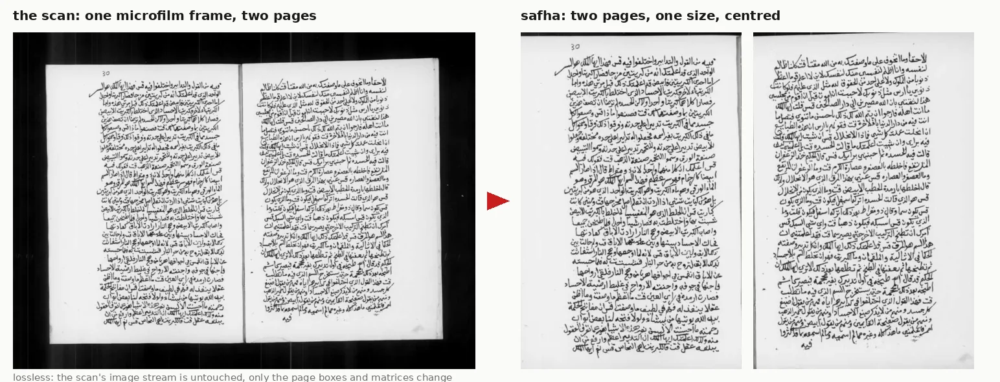

# safha

**Lossless crop, deskew and split for scanned book PDFs.** One box per book, centred on every page's text; tilted pages
levelled only when two measures agree; two-page spreads split; the scan's images never re-encoded. For reading on a
phone, a Kindle, a Kobo or a reMarkable, in any script.

[](https://github.com/kmbenjel/safha/actions/workflows/ci.yml)
[](https://pypi.org/project/safha/)
[](https://pypi.org/project/safha/)
[](LICENSE)



```bash
uvx safha demo                 # the bundled public-domain samples, before | after sheets, under a minute
pipx install safha
safha crop book.pdf            # -> book.safha.pdf: same images, same size, text larger on screen
```

*safha* (صفحة) is Arabic for "page".

## Why safha? How it compares

Scanned books read badly on small screens: wide margins shrink the text, pages sway from left to right, some are
tilted, some scans hold two pages. The usual fixes either crop page by page (every page a different size), or
rasterise and re-encode every page (a 600 dpi bitonal scan comes back blurred, bigger, or both).

safha does the whole job **through the PDF's drawing instructions**: each page's visible box and a transformation
matrix. The image streams stay byte for byte, the file keeps its size, and the original can be restored from the
output.

| | safha 0.1 | pdfCropMargins 2.2.1 | Briss 2.0a5 | k2pdfopt 2.55 | ScanTailor Advanced 1.0 | unpaper 7.0 | OCRmyPDF 15.2 `--deskew` |
|---|---|---|---|---|---|---|---|
| Keeps the scan's image streams (lossless) | ✓ R | ✓ R | ✓ R | ✗ R (re-rendered) | ✗ D (TIFF output) | ✗ R (raster in, raster out) | ✗ R (deskewed pages re-encoded) |
| One page size for the whole book | ✓ R | ✓ R (`-u -s`) | partial R | partial R (device pages) | ✓ D | ✗ D (works on images) | ✗ R |
| Text centred on every page | ✓ R | ✗ R | ✗ R | n/a (reflowed) | ✓ D | partial D | ✗ |
| Deskew | ✓ R | ✗ D | ✗ D | ✓ R (`-as`) | ✓ D | partial R (0 of 3 test pages) | ✓ R |
| Refuses a turn that makes level lines lean (warped leaves) | ✓ R | n/a | n/a | n/a (reflowed) | ✗ D (dewarps instead) | ✗ R | ✗ R |
| Printed frame decides the tilt; sheared print levelled | ✓ R | ✗ | ✗ | ✗ | ✗ D | ✗ D | ✗ D |
| Splits two-page spreads | ✓ R | ✗ D | partial D (manual, GUI) | partial D (columns) | ✓ D | ✓ D (`--layout double`) | ✗ D |
| Dewarps curved lines | ✗ | ✗ | ✗ | ✗ | ✓ D | ✗ | ✗ |
| Reflows text for narrow screens | ✗ | ✗ | ✗ | ✓ R | ✗ | ✗ | ✗ |
| OCR text layer | keeps an existing one | ✗ | ✗ | ✓ D (`-ocr`) | ✗ | ✗ | ✓ D |
| Batch command line | ✓ R | ✓ R | ✓ R (`-s -d`) | ✓ R | ✗ D (GUI only) | ✓ R | ✓ R |
| Review sheet of what it did | ✓ R (`safha sheet`) | partial D (`-gui`) | ✓ D (GUI) | partial D (preview) | ✓ D (GUI) | ✗ | ✗ |
| Output restorable to the original bytes | ✓ R | ✗ | ✗ | ✗ | ✗ | ✗ | ✗ |

R: checked by running it on the benchmark pages below (2026-11-13, Ubuntu 24.04 packages, pdfCropMargins and Briss from
their releases). D: from the tool's documentation (2026-11-13). The script that produced the R cells is
[`bench/compare.sh`](bench/compare.sh).

### What the difference looks like, measured

Four 40-page excerpts of public-domain scans (an Arabic print in colour, JPEG 2000; an English print, JPEG 2000; an
Urdu print, bitonal CCITT G4; an Arabic manuscript on microfilm) and a synthetic book with a known truth, each run
through every tool with its usual command ([full tables](bench/results/compare.md)):

| | size of the output | image streams kept byte for byte | codec after | tilted pages levelled | warped pages wrongly turned |
|---|---:|---:|---|---:|---:|
| **safha** | **100-102 %** | **100 %** | **unchanged** | **3/3** | **0/3** |
| pdfCropMargins | 100 % | 100 % | unchanged | 0/3 (no deskew) | 0/3 |
| Briss | 100 % | 100 % | unchanged | 0/3 (no deskew) | 0/3 |
| k2pdfopt | 25-326 % | 0 % | Flate (re-rendered) | n/a (reflowed) | n/a |
| unpaper | 541-783 % | 0 % | Flate (re-rendered) | 0/3 | 2/3 |
| OCRmyPDF `--deskew` | 286-6551 % | 0 % | Flate (re-encoded) | 3/3 | 3/3 |

Only safha both levels the tilted pages and leaves the warped ones alone; the two other tools that deskew turned
warped pages, so that their level lines now lean. The lossless croppers (pdfCropMargins, Briss) keep the pixels but do
not deskew, centre the text page by page, or split spreads.


### Five differences, with the evidence

1. **Nothing is re-encoded.** Over 17 public-domain books (7,998 pages: JPEG 2000, JBIG2, CCITT G4, colour and
   bitonal), every image codec came out unchanged and every image stream byte for byte; the files grew by 0.70 % in the
   reversible mode and by 0.02 % with `--compact`. On the same excerpts, the two tools that deskew by re-rendering made
   the files 2.9 to 65 times larger (OCRmyPDF) and 5.4 to 7.8 times larger (unpaper).
2. **One box per book, on every page's text.** Every output page has the book's size to 0.01 pt (checked by `apply`). On the
   microfilmed manuscript, the text filled 67 % of the page width before and 79 % after, its centre within 0.3 % of the
   page's (pdfCropMargins: 63 % and 3.1 %; Briss: 54 % and 23 %); on the Urdu excerpt the text's place swayed 0.9 % of
   the page width from page to page before and 0.1 % after (pdfCropMargins: 1.2 %).
3. **No invented tilt.** On a synthetic book with a known truth (three pages tilted 1 degree, three warped pages whose
   upper lines are level and lower lines tilted 1.5 degrees), safha levelled the three tilted pages and turned none of the warped ones; OCRmyPDF's
   deskew turned all three warped pages and unpaper two, so that their level upper lines now lean. Across the
   7,998-page corpus, 85 pages whose lines lie at two angles were left as scanned and listed.
4. **The printed frame is the ruler.** A frame's sides decide the turn of a framed page, and a frame printed as a
   parallelogram is sheared level (tested in `tests/test_tilt.py`; no other tool listed does either).
5. **Reviewable and reversible.** `safha plan` writes every decision to a JSON recipe, `safha sheet` draws the box on
   the scan beside the result, and `safha restore` gives back the original file byte for byte (MD5 checked).

### When to use something else

- Your pages are **curved** (a thick book photographed open): ScanTailor Advanced dewarps them; safha leaves a warped
  page as scanned rather than make it worse.
- You read on a **very small e-ink screen** and want the text **reflowed** into one narrow column: k2pdfopt.
- You need **searchable text**: run OCRmyPDF on safha's output, without `--deskew`, and the images stay untouched.
- You want **clean pixels** (despeckle, binarise, whiten the paper) and accept re-encoding: unpaper or ScanTailor.
- You need to crop a **born-digital** PDF's white margins quickly: pdfCropMargins is simpler for that.

## Features

- **Crop**: one box size per book (the content width of 95 % of the typical pages plus a margin), placed on each
  page's text block; short pages keep their neighbours' place; odd and even pages laid out by parity only when the
  book prints in its margins.
- **Not content, kept outside**: scanner bands, edge shadows, specks and dust, the edges of a photocopied sheet,
  streaks and blots. **Content, kept inside**: marginal notes, figures, printed rules and frames, page numbers.
- **Deskew**: the ink-shear profile on the whole page and on its halves, checked on the turned page by the page image
  itself; each line followed across the page to refuse turns that make level lines lean.
- **Printed frames**: a frame's sides decide its page's tilt; a parallelogram frame is sheared level.
- **Spreads**: wide sheets split into two pages (right page first with `--rtl`); wrap-around covers split.
- **Covers**: a cover photographed on the scanner bed shown alone.
- **One page size**: pages holding more than the box (a plate, a wide table) are drawn smaller, never cut.
- **Recipes**: plain JSON, re-appliable; `safha inspect` prints them page by page.
- **Review**: `safha sheet` draws the box on the scan beside the result (an image, an HTML folder, or review cards
  for [agent-workbench](https://warraq.benjelloun.dev/agent-workbench/) pages).
- **Reversible**: the output starts with the original bytes; `safha restore`; `safha drop` for blank pages and covers.
- **Any script, any direction**: the measures read ink and lines, not letters. Tested on Arabic, Urdu, Latin and
  handwritten pages.
- **Profiles**: `warraq` (default: crop when it pays), `reader`, `eink`, `crop-only`; every threshold settable.

## Usage

```bash
safha crop book.pdf -o book.phone.pdf --jobs 4     # plan + apply, checked
safha crop scans.pdf --rtl                         # Arabic, Hebrew, Persian, Urdu spreads: right page first
safha crop book.pdf --profile eink                 # tight margins for e-ink readers
safha plan book.pdf -o book.json --pretty          # decisions only (JSON)
safha inspect book.json                            # page by page: kind, tilt, turn, shown part, flags
safha sheet book.pdf -o sheet.jpg                  # before | after of the telling pages
safha sheet book.pdf --html review --all           # an HTML review folder, every page
safha sheet book.pdf --cards cards/                # review cards (JSON lines + images) for a review page
safha apply book.pdf book.json -o out.pdf          # write a (possibly edited) recipe
safha restore out.pdf -o original.pdf              # the original bytes back
safha drop book.pdf --blank -o book.pdf            # blank pages among the first and last four, losslessly
safha bench books/ -o results.json                 # speed, sizes, turns over many books
```

```python
import safha

recipe = safha.plan("book.pdf", profile="reader", jobs=4)   # a JSON-ready dict; nothing written
print(recipe["mode"], recipe["size"], recipe["summary"]["turned"])
report = safha.apply_recipe("book.pdf", recipe, "book.safha.pdf")
```


## How it works

```mermaid
flowchart LR
    A[scanned PDF] --> S{spreads?}
    S -- wide sheets --> SP[split: two CropBoxes per sheet]
    S -- no --> M
    SP --> M[DETECT: every page at 500 px<br/>text block, stains, rules, tilt]
    M --> L[second look at the tilt, 1000 px<br/>two measures, line by line, printed frame]
    L --> D[DECIDE: one box per book<br/>placed on each page's text]
    D --> C[CHECK at 1000 px: no text outside<br/>the box, else slide, grow or keep whole]
    C --> F[FRAMES: one page size]
    F --> R[(recipe.json)]
    R --> P[APPLY: CropBox + cm matrix,<br/>incremental save, verified]
```



The full method and the reasons behind each rule are in [docs/design.md](docs/design.md).

## Benchmark

17 public-domain books from the Internet Archive (Arabic, Persian, Urdu, Telugu, English and French; prints from 1853 to
1915, microfilmed manuscripts, Google and Digital Library of India scans), default profile, on a shared 32-core VM:

| | |
|---|---|
| books / pages | 17 / 7,998 (0 errors) |
| written | 13 cropped, 4 levelled only (well-cropped scans whose only flaw was tilted pages) |
| image codecs unchanged | 17 of 17 books (JPEG 2000, JBIG2, CCITT G4) |
| size | 504.6 MB in, 508.1 MB out (+0.70 %, reversible); +0.02 % with `--compact` |
| pages turned | 863 of 7,776 text pages (11.1 %) |
| left as scanned, lines at two angles | 85 pages |
| speed | 1.37 pages/s per book with 3 worker processes; 5.0 pages/s with 4 books at once |

Per book: [bench/results/bench.md](bench/results/bench.md); corpus with years and licences:
[bench/results/corpus.tsv](bench/results/corpus.tsv).

Reproduce: `python bench/fetch_corpus.py CORPUS && safha bench CORPUS -o results.json` (the corpus list, with each
book's year and licence, is written to `CORPUS/corpus.tsv`).

## Design decisions

- **Drawing instructions, not pixels.** Lossless by construction, and verified after every write.
- **Two witnesses for every turn**, and a line-by-line check: a page left tilted is a small fault, a page made to lean
  is a new one.
- **One size per book**: a reader's zoom and the text's place stay still from page to page.
- **Crop only when it pays** (default profile): a well-made scan is left alone.
- **Recipes as the contract** between the method and the writer: reviewable, editable, re-appliable.
- **Thresholds in one profile object**, all overridable; the defaults were tuned page by page on a 16,700-volume
  library of scanned Arabic books, then tested on Latin, Urdu and handwritten pages.

## Roadmap

- Fill the scanner bed beyond a short sheet's edge with the paper's colour (a vector patch, still lossless).
- Folio-anchored placement of short pages; two-column index pages measured column by column.
- Uploader stamps and coloured marks kept outside the box.
- A browser demo: the same engine on [Pyodide](https://pyodide.org) (PyMuPDF, NumPy and SciPy have WebAssembly
  builds), so a reader can drop a PDF on a static page and get it back cropped, with nothing uploaded.

## Contributing

Bug reports with a page that went wrong are the most valuable contribution: see [CONTRIBUTING.md](CONTRIBUTING.md).
The Arabic documentation is at [warraq.benjelloun.dev/safha](https://warraq.benjelloun.dev/safha/).

## Licence

Code: MIT. Sample pages: public domain (sources in [docs/media/SOURCES.md](docs/media/SOURCES.md)).
