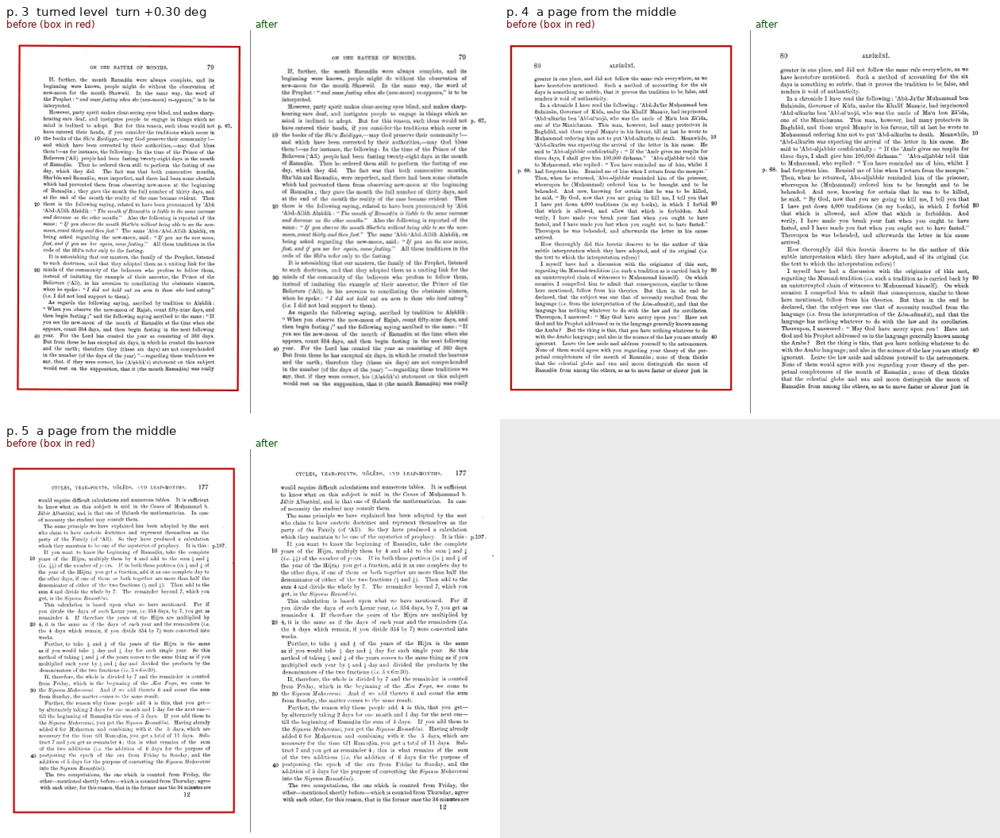

# مراجعة النتيجة

لا تنقل كتابا إلى هاتفك قبل أن تنظر في صفحاته المهمّة. تختار الأداة هذه الصفحات وحدها: الصفحات التي أُديرت، والتي
تُركت لأن أسطرها على زاويتين، والتي بقيت كاملة، والتي فيها بقع، وصفحتين متقابلتين من وسط الكتاب.

```bash
safha sheet book.pdf -o book-sheet.jpg
```

في كل زوج: الصورة الأصلية والإطار عليها بالأحمر (والبقع المستبعدة بالبرتقالي)، ثم الصفحة كما سيعرضها القارئ.



## صفحات بعينها

```bash
safha sheet book.pdf --pages 12,40-42 -o pages.jpg
```

## صفحة مراجعة كاملة

```bash
safha sheet book.pdf --html review --all
```

يكتب مجلدا فيه `index.html` تُحمَّل صوره عند التمرير، فيُفتح حتى على الهاتف.

## الأرقام صفحة صفحة

```bash
safha inspect book.pdf
```

يطبع لكل صفحة: نوعها، والميل المقيس، وزاوية التدوير، وقراءة المقياسين بعد التدوير، والجزء الظاهر، والملاحظات مثل
`two_angles` (أسطر على زاويتين: تُركت) و`frame_turn` (قُوّمت بإطارها المطبوع).
