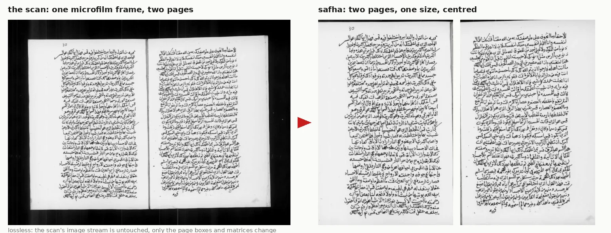

# صفحة: قصّ الكتب المصوّرة وتقويمها بلا فقد

**صفحة** أداة سطر أوامر ومكتبة بايثون تجهّز الكتب المصوّرة (PDF) للقراءة على الهاتف والقارئ الإلكتروني
(كندل وكوبو وريماركبل) وعلى الشاشة الصغيرة عامة. تفعل أربعة أشياء:

- **تقصّ الهوامش** بإطار واحد للكتاب كله، تضعه على نصّ كل صفحة فيتوسّطها، فلا تتمايل الصفحات ولا يتغيّر مقاسها
  من صفحة إلى أخرى.
- **تقوّم الصفحات المائلة**، ولا تدير صفحة إلا إذا اتفق مقياسان مستقلان على ميلها وعلى استوائها بعد التدوير.
- **تفصل الصفحتين المصوّرتين في لقطة واحدة** إلى صفحتين، من اليمين إلى اليسار أو العكس.
- **تُخرج الغلاف المصوّر على سطح الماسح** وحده، وتحذف عند الطلب الصفحات البيضاء التي تُفسد ترقيم الكتاب.

## ما الذي يميّزها؟

الصورة الممسوحة لا تُفكّ ولا يُعاد ضغطها أبدا: تغيّر صفحة «تعليمات الرسم» وحدها (الإطار الظاهر من الصفحة ومصفوفة
التدوير)، فيبقى الملف بجودته وحجمه، ويمكن استرجاع الأصل منه بايتًا بايتًا. والتفصيل في [ما الذي يميّزها؟](why.md).

## لمن هذه الأداة؟

لكل من يقرأ كتبا مصوّرة على شاشة صغيرة: طلبة العلم والباحثين وأمناء المكتبات الرقمية، بالعربية وبغيرها من اللغات.
وقد صُقلت قواعدها على مكتبة من نحو ستة عشر ألف مجلد عربي مصوّر، ثم عُمّمت لكل خط ولكل اتجاه كتابة.

## ابدأ

- [التثبيت](install.md)
- [البدء السريع](quickstart.md): تجربة على عيّنة مرفقة في أقل من دقيقة.
- [قصّ كتاب كامل](guides/crop-a-book.md)، [مراجعة النتيجة](guides/review.md)، [التراجع واسترجاع الأصل](guides/undo.md)،
  [الملفات الشخصية والإعدادات](guides/profiles.md).
- [أسئلة شائعة](faq.md).

وصفحة جزء من عائلة «ورّاق» لأدوات المكتبات العربية الرقمية؛ ومنها [planfs](/planfs/) لتنفيذ خطط النقل والتسمية
بأمان، و[pocketshelf](/pocketshelf/) لفهرسة مجلد من الكتب في صفحة واحدة تعمل دون اتصال.
