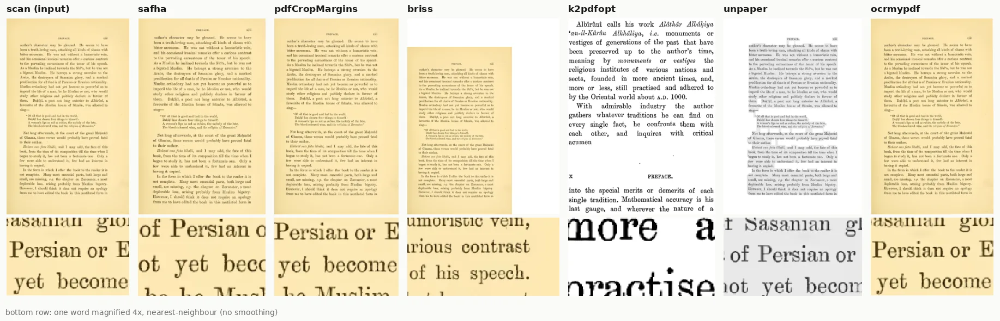

# ما الذي يميّزها؟

حين تريد أن تقرأ كتابا مصوّرا على الهاتف أو القارئ الإلكتروني تجد أمامك أدوات كثيرة. بعضها يقصّ الهوامش فقط، وبعضها
يعيد رسم كل صفحة صورةً جديدة. وصفحة تجمع ما لا تجمعه غيرها: تقصّ وتقوّم وتفصل، ثم تترك الصورة الممسوحة كما هي.

## الفرق في جملة

الأدوات التي تقوّم الميل أو تنظّف الصفحة (k2pdfopt وunpaper وOCRmyPDF وScanTailor) تحوّل كل صفحة إلى صورة نقطية ثم
تضغطها من جديد، فتتغيّر نقاط الصورة نفسها، وقد يتضاعف حجم الملف أو تضيع دقائق الحروف والنقاط والحركات. والأدوات التي
لا تمسّ الصورة (pdfCropMargins وBriss) تقصّ فقط، فلا تقوّم صفحة ولا توسّط نصا ولا تفصل صفحتين. أمّا صفحة فتفعل ذلك كله
بتعليمات الرسم وحدها.

## موازنة الخصائص

| الخاصية | صفحة | pdfCropMargins | Briss | k2pdfopt | ScanTailor Advanced | unpaper | OCRmyPDF مع `--deskew` |
|---|---|---|---|---|---|---|---|
| تُبقي صورة المسح كما هي | نعم | نعم | نعم | لا | لا | لا | لا |
| مقاس واحد لصفحات الكتاب كلها | نعم | نعم | جزئيا | جزئيا | نعم | لا | لا |
| النص في وسط كل صفحة | نعم | لا | لا | لا ينطبق (يعيد تدفق النص) | نعم | جزئيا | لا |
| تقويم الميل | نعم | لا | لا | نعم | نعم | جزئيا (لم يقوّم أيا من صفحات الاختبار الثلاث) | نعم |
| ترفض تدويرا يُميل الأسطر المستوية | نعم | لا ينطبق | لا ينطبق | لا ينطبق | لا (تقوّم الانحناء بإعادة الرسم) | لا | لا |
| الإطار المطبوع معيار الميل | نعم | لا | لا | لا | لا | لا | لا |
| فصل الصفحتين المصوّرتين معا | نعم | لا | يدويا | جزئيا | نعم | نعم | لا |
| تقويم الأسطر المنحنية | لا | لا | لا | لا | نعم | لا | لا |
| طبقة نص (OCR) | تحفظ الموجودة | لا | لا | نعم | لا | لا | نعم |
| تعمل من سطر الأوامر على دفعات | نعم | نعم | نعم | نعم | لا (واجهة رسومية فقط) | نعم | نعم |
| استرجاع الأصل بايتا بايتا | نعم | لا | لا | لا | لا | لا | لا |

جُرّبت الأدوات كلها على الصفحات نفسها في 13 نونبر 2026 (إلا ScanTailor Advanced فليس له سطر أوامر، فأُخذت خصائصه
من وثائقه). والسكربت الذي أنتج الأرقام منشور في المستودع: `bench/compare.sh`.

## بالأرقام

جرّبنا الأدوات كلها على أربعة مقتطفات، في كل مقتطف أربعون صفحة من كتب الملك العام المصوّرة في أرشيف الإنترنت:
«المقدمة» لابن خلدون (القاهرة 1904، صور ملوّنة)، وترجمة «الآثار الباقية» للبيروني (لندن 1879)، وكتاب أردي من
مكتبة الهند الرقمية (صور أبيض وأسود بترميز CCITT)، ومخطوط عربي مصوّر على ميكروفيلم. ثم على كتاب اصطناعي نعرف
حقيقته: ثلاث صفحات مائلة درجةً واحدة، وثلاث صفحات متموّجة أسطرها العليا مستوية والسفلى مائلة درجةً ونصفا.

| الأداة | حجم الناتج | صور المسح المحفوظة كما هي | الصفحات المائلة التي قُوّمت | الصفحات المتموّجة التي أُديرت خطأً |
|---|---:|---:|---:|---:|
| **صفحة** | **100-102٪** | **100٪** | **3 من 3** | **0 من 3** |
| pdfCropMargins | 100٪ | 100٪ | 0 (لا تقوّم) | 0 |
| Briss | 100٪ | 100٪ | 0 (لا تقوّم) | 0 |
| k2pdfopt | 25-326٪ | 0٪ | لا ينطبق (يعيد تدفق النص) | لا ينطبق |
| unpaper | 541-783٪ | 0٪ | 0 من 3 | 2 من 3 |
| OCRmyPDF مع `--deskew` | 286-6551٪ | 0٪ | 3 من 3 | 3 من 3 |

وعلى مجموعة أكبر من سبعة عشر كتابا (7998 صفحة، بالعربية والفارسية والأردية والتلغوية والإنجليزية والفرنسية) بقيت
ترميزات الصور كلها كما هي، وزاد حجم الملفات 0.70٪ فقط في الوضع القابل للاسترجاع، و0.02٪ مع `--compact`. وأُديرت
863 صفحة من 7776 صفحة نص (11.1٪)، وتُركت 85 صفحة كما صُوّرت لأن أسطرها على زاويتين.

## متى تختار غيرها؟

- إذا كانت صفحات الكتاب **منحنية** لأنه صُوّر مفتوحا: ScanTailor Advanced يقوّم الانحناء. أمّا صفحة فتترك الصفحة
  المتموّجة كما هي، لأنّ تدويرها يزيدها سوءا.
- إذا أردت أن **يُعاد تدفق النص** في عمود ضيق على شاشة حبر صغيرة: k2pdfopt.
- إذا أردت **نصا قابلا للبحث**: شغّل OCRmyPDF على ناتج صفحة دون `--deskew`، فلا تُمسّ الصور.
- إذا أردت **تنظيف الصورة** نفسها (إزالة النقط وتبييض الورق) وقبلت إعادة الضغط: unpaper أو ScanTailor.

## لماذا يهمّ هذا لقارئ الكتب العربية؟

النقاط والحركات في الخط العربي دقيقة، وإعادة ضغط صورة نصفها حبر وأكثرها هوامش تعبث بها أول ما تعبث. والكتب القديمة
المطبوعة في بولاق أو المصوّرة عن المخطوطات كثيرا ما تكون أوراقها متموّجة أو أسطرها مائلة ميلا متزايدا، فإذا أدارتها
أداة بمتوسط الميل استوى نصف الصفحة ومال نصفها الآخر. وقد صُمّمت صفحة على هذه الكتب بالذات، ثم عُمّمت لكل خط.
