# How safha works

safha changes how a scanned page is **drawn**, never the scan itself. A page of a scanned PDF is an image plus a few
drawing instructions; safha rewrites only the instructions:

| What safha writes | Effect | Undo |
|---|---|---|
| the page's `CropBox` | the part of the page shown | the original box is in the original bytes |
| `q a b c d e f cm` ... `Q` around the page content | the same image drawn turned, sheared, moved or scaled | remove the two streams |
| two `CropBox`es over one sheet (`fullcopy_page`) | a two-page spread shown as two pages; the image is shared, not copied | delete the second page |
| an incremental update appended to the file | everything above; the original file is the first N bytes | `safha restore` truncates and checks the MD5 |

After writing, `apply` re-opens the result and refuses it unless it has the expected pages, every image stream is byte
for byte the input's (compared by MD5 of the raw, still-compressed streams), and every page has the book's size. The
copy is written and checked under a temporary name beside the output and takes the output's name only then: a refused
run leaves nothing on disk, and an output that was there before stays as it was.

The method measures a page **as it is shown**, and writes it back **as the file stores it**. A page kept sideways and
shown upright by a `/Rotate` entry, a page counted in another unit (`/UserUnit`), a CropBox that sits inside the
MediaBox or off its origin, a box inherited from the page tree or written as an object of its own: one matrix, from the
file's coordinates to the shown page, carries every box and every turn across, and a test holds it to what MuPDF
draws.

What else the file carries stays as it is: an OCR text layer is part of the page's content, so it turns and moves with
the scan; the outline and its targets, and encryption with an owner password, are kept. Links and form fields keep
their own coordinates: on a page that was only cropped they stay on their words, on a page that was turned, moved or
drawn smaller they sit off by that much.

## The pipeline

```mermaid
flowchart LR
    A[scanned PDF] --> S{spreads?}
    S -- wide sheets --> SP[split: two CropBoxes per sheet]
    S -- no --> M
    SP --> M[DETECT: first look, every page at 500 px<br/>marks, text block, stains, rules, tilt]
    M --> L[second look at the tilt, 1000 px<br/>two measures, line by line, margins,<br/>printed rules and frame]
    L --> D[DECIDE: one box size per book<br/>placed on each page's text]
    D --> C[CHECK at 1000 px: nothing of the text<br/>outside the box, no line of print cut,<br/>else slide, grow or keep whole]
    C --> F[FRAMES: one page size for every page]
    F --> R[(recipe.json)]
    R --> P[APPLY: CropBox + cm, incremental save,<br/>checked: same pages, same image streams, one size]
    P --> O[cropped PDF]
```

Every stage reads and writes plain data: the recipe is the contract between the method and the PDF writer, so a run can
be reviewed (`safha inspect`, `safha sheet`), edited by hand, archived, and re-applied (`safha apply`) without measuring
again.

## Design decisions

**Lossless by construction.** Cropping and turning through drawing instructions means the output keeps the scan's
resolution, codec (JPEG, JPEG 2000, JBIG2, CCITT G4) and size. Tools that rasterise and re-encode trade the scan's
pixels for their own: a turned page is resampled, and a colour or grey scan stored again comes back several times
larger, or lossy.

**One box per book, not per page.** Per-page crops make the pages of a book different sizes, so the text jumps and
the reader's zoom changes from page to page. safha measures the text block of every page, takes the width of 95 % of
the typical pages (else 98 %, else all), adds a margin, and places that same box on each page's text. Pages whose
content is larger (a plate, a wide table) are shown whole, drawn smaller, at the same page size. When more than 5 %
of the text pages are like that, no one box fits the book and it is not cropped; a sheet of another size (a quarter
larger than the median page: a chart, a frame filmed at another scale) is shown whole in any case and does not count.

**Centred on the text, not on the ink.** The text block is measured mark by mark (2nd to 98th percentile of the marks'
edges, then widened by gaps), so one heavy streak or a scanner band cannot drag it. Short pages (a chapter end) keep
the place of their full neighbours, corrected by their own scan shift, so their lines do not jump.

**Not everything dark is content.** Scanner bands, edge shadows, isolated specks, dust, the photographed edges of a
photocopy, streaks and blots are kept outside the box; everything else is content, however faint: marginal notes,
printed rules and frames, folio numbers. A "stain" that repeats at the same place on many pages is print (an
ornament) and comes back in. Pixels are never cleaned: a speck is only left outside the box.

A turned page shows nothing beyond the scan's own sheet: a blank wedge at each edge. Where the scan ends in a scanner
band, the bed went on there, and the bands of a turned page are read as if it did. Without that the wedge hides the
band behind it, the whole bed passes for content, and a leaf that lay askew on a dark bed would be the one page of its
book left uncropped.

**A turn needs two witnesses.** The tilt is read by the ink-shear profile on the whole page and on its two halves
(index pages, two columns and verse fool the whole page alone); a turned page is kept only when that measure and an
independent one (the page image itself, rotated and projected) both read it level. When unsure, the page stays as
scanned and is listed.

**Never invent a tilt.** Every turn is checked line by line: each line is followed across the page strip by strip, on
the page as scanned and as turned. If the turn would make level lines lean (a warped leaf whose upper lines are level
and lower ones tilted, a block of verse set at its own angle), the page is left as scanned. One rotation cannot fix
a warped page; it only moves the tilt from one half to the other. A printed rule across the text is held to the same
test: a turn that makes a level rule lean is undone.

**What the print holds upright outranks what the ink's profile says.** A row profile sharpens at the wrong angle when
the two ends of a line stand at different heights: a headword and its gloss in another script, an entry and its page
number, two columns whose lines do not face each other. Such pages carry their own standard:

- a single printed rule between two columns is the page's upright: the page is turned by the rule's lean, or not
  at all. The lines, followed one by one, keep the last word: when they object to that turn (a rule set askew to
  its lines), the page stays as scanned;
- on any other page, the text's own margins are witnesses (each flush edge that ten lines or more stand on, read on
  the page as scanned and again on the page as turned): when every one of them stands upright, leans the other way,
  or shows less than half the tilt the turn was made for, the turn is refused, unless the page's printed rules
  certify it (a print whose lines and rules lean one way and its margins another is levelled by its lines). Margins
  that lean with the lines refuse nothing.

A rule that is bent (its halves lean apart, or squaring the whole would make one half lean more than it does) means
a warped leaf: it stays as scanned. Two columns with only a white gutter between them, and tables (a grid of rules
is no standard for its rows), are measured like any other page: the edges of columns lean with the setting as often
as with the page, and turn nothing on their own.

**A printed frame is the standard.** On a page whose text stands inside a printed frame, the frame's sides decide the
turn, whatever the lines read (the lines of an old lithograph often lean more and more down the page). A frame that is
a parallelogram (sides upright, rules leaning by 1.25 to 3 degrees) is sheared level by the same lossless matrix; a
warped or keystoned frame is left alone.

**No line of print is cut.** The box is checked twice at 1,000 px. First against the marks the first look called
content. Then against the page image itself, read around the box's edge without that sorting: a letter the edge runs
through, a row of letters that starts inside the box and goes on beyond it (a marginal note that reaches the scan's
edge), a whole row of print above or below it (a running head, a last line the first look took for the sheet's edge).
The box slides to take them in, or grows with the same proportions, or the page is shown whole. The same reading
guards the two places where a page is shown through a smaller window than its box: a page drawn a little larger to
fill the book's size, and the thin strip a levelled book on grey paper loses on every side.

**Crop only when it pays.** The default profile crops a book when the text gets at least 15 % larger on a small
screen, or when the scan has a flaw worth fixing (tilted pages, scanner bands, text off-centre or swaying, stains). A
well-made scan is left as it is; `--profile reader` crops it anyway.

## What safha does not do

- Dewarp curved lines (that needs resampling the image: ScanTailor does it).
- Clean, binarise, despeckle or recompress pixels (unpaper, ScanTailor, OCRmyPDF's optimiser do).
- Reflow text into a narrow column (k2pdfopt does).
- OCR (run OCRmyPDF on safha's output, without `--deskew`, to keep the images).

## Limits

- A page is turned as a whole or not at all. A page whose witnesses disagree (lines at two angles, margins against
  lines, a bent column rule) stays as scanned and is listed in the summary and in `safha inspect`.
- A page with fewer than eight lines of text, or fewer than a hundred letters, has too little to read a tilt from: it
  is turned only by its printed frame or its column rule, and otherwise stays as scanned.
- A file MuPDF has to repair on reading (a broken cross-reference table) takes no incremental update: its output is
  written whole and checked the same, and `safha restore` cannot give the original back from it. The run says so.
- The reading order of split spreads comes from `--rtl` / `--ltr`, else from the file's text layer; a file with no
  text layer is split left page first, and the summary says so.
- A marginal note is kept when it is a group of three strokes or more, or runs on from the text; a lone mark in the
  margin of a book that prints nothing there (a pencil stroke, a single sign) is left outside the box.
- A cover (a cover photographed on the scanner bed, a picture page at either end of the book) fills the page: a
  strip of it is left out at two opposite edges to match the book's proportions. A cover found on the scanner bed
  loses at most 4 % at each edge, or is shown whole; a picture page at either end of the book is cut to the
  proportions whatever the strip (in the benchmark: 3 % or less at each edge in seven printed books, 8 to 10 % on the
  boards of an eighth, 18 to 24 % on the first and last frames of the two microfilmed manuscripts).
- Encryption with a user password is refused; with an owner password alone the file is processed and stays encrypted.
- `--compact` rewrites the file: smaller, but `safha restore` cannot give the original back.

## Thresholds

All thresholds live in `safha.profile.Profile` and can be changed per run (`--set name=value`) or in a TOML/JSON
profile (`--profile my.toml`, with `base = "eink"` to start from a built-in one). `safha profiles -v` lists them.
