# How safha works

safha changes how a scanned page is **drawn**, never the scan itself. A page of a scanned PDF is an image plus a few
drawing instructions; safha rewrites only the instructions:

| What safha writes | Effect | Undo |
|---|---|---|
| the page's `CropBox` | the part of the page shown | the original box is in the original bytes |
| `q a b c d e f cm` ... `Q` around the page content | the same image drawn turned, sheared, moved or scaled | remove the two streams |
| two `CropBox`es over one sheet (`fullcopy_page`) | a two-page spread shown as two pages; the image is shared, not copied | delete the second page |
| an incremental update appended to the file | everything above; the original file is the first N bytes | `safha restore` truncates and checks the MD5 |

After writing, `apply` re-opens the result and refuses it unless it has the expected pages, every image stream is byte
for byte the input's (compared by MD5 of the raw, still-compressed streams), and every page has the book's size.

## The pipeline

```mermaid
flowchart LR
    A[scanned PDF] --> S{spreads?}
    S -- wide sheets --> SP[split: two CropBoxes per sheet]
    S -- no --> M
    SP --> M[DETECT: first look, every page at 500 px<br/>marks, text block, stains, rules, tilt]
    M --> L[second look at the tilt, 1000 px<br/>two measures, line by line, printed frame]
    L --> D[DECIDE: one box size per book<br/>placed on each page's text]
    D --> C[CHECK at 1000 px: nothing of the text<br/>outside the box, else slide, grow or keep whole]
    C --> F[FRAMES: one page size for every page]
    F --> R[(recipe.json)]
    R --> P[APPLY: CropBox + cm, incremental save,<br/>checked: same pages, same image streams, one size]
    P --> O[cropped PDF]
```

Every stage reads and writes plain data: the recipe is the contract between the method and the PDF writer, so a run can
be reviewed (`safha inspect`, `safha sheet`), edited by hand, archived, and re-applied (`safha apply`) without measuring
again.

## Design decisions

**Lossless by construction.** Cropping and turning through drawing instructions means the output keeps the scan's
resolution, codec (JPEG, JPEG 2000, JBIG2, CCITT G4) and size. Tools that rasterise and re-encode trade the scan's
pixels for their own; on a 600 dpi bitonal scan that can multiply the file size or blur thin strokes and diacritics.

**One box per book, not per page.** Per-page crops make the pages of a book different sizes, so the text jumps and
the reader's zoom changes from page to page. safha measures the text block of every page, takes the width of 95 % of
the typical pages (else 98 %, else all), adds a margin, and places that same box on each page's text. Pages whose
content is larger (a plate, a wide table) are shown whole, drawn smaller, at the same page size.

**Centred on the text, not on the ink.** The text block is measured mark by mark (2nd to 98th percentile of the marks'
edges, then widened by gaps), so one heavy streak or a scanner band cannot drag it. Short pages (a chapter end) keep
the place of their full neighbours, corrected by their own scan shift, so their lines do not jump.

**Not everything dark is content.** Scanner bands, edge shadows, isolated specks, dust, the photographed edges of a
photocopy, streaks and blots are kept outside the box; everything else is content, however faint: marginal notes,
printed rules and frames, folio numbers. A "stain" that repeats at the same place on many pages is print (an
ornament) and comes back in. Pixels are never cleaned: a speck is only left outside the box.

**A turn needs two witnesses.** The tilt is read by the ink-shear profile on the whole page and on its two halves
(index pages, two columns and verse fool the whole page alone); a turned page is kept only when that measure and an
independent one (the page image itself, rotated and projected) both read it level. When unsure, the page stays as
scanned and is listed.

**Never invent a tilt.** Every turn is checked line by line: each line is followed across the page strip by strip, on
the page as scanned and as turned. If the turn would make level lines lean (a warped leaf whose upper lines are level
and lower ones tilted, a block of verse set at its own angle), the page is left as scanned. One rotation cannot fix
a warped page; it only moves the tilt from one half to the other.

**A printed frame is the standard.** On a page whose text stands inside a printed frame, the frame's sides decide the
turn, whatever the lines read (the lines of an old lithograph often lean more and more down the page). A frame that is
a parallelogram (sides upright, rules leaning by 1.25 to 3 degrees) is sheared level by the same lossless matrix; a
warped or keystoned frame is left alone.

**Crop only when it pays.** The default profile crops a book when the text gets at least 15 % larger on a small
screen, or when the scan has a flaw worth fixing (tilted pages, scanner bands, text off-centre or swaying, stains). A
well-made scan is left as it is; `--profile reader` crops it anyway.

## What safha does not do

- Dewarp curved lines (that needs resampling the image: ScanTailor does it).
- Clean, binarise, despeckle or recompress pixels (unpaper, ScanTailor, OCRmyPDF's optimiser do).
- Reflow text into a narrow column (k2pdfopt does).
- OCR (run OCRmyPDF on safha's output, without `--deskew`, to keep the images).

## Thresholds

All thresholds live in `safha.profile.Profile` and can be changed per run (`--set name=value`) or in a TOML/JSON
profile (`--profile my.toml`, with `base = "eink"` to start from a built-in one). `safha profiles -v` lists them.
